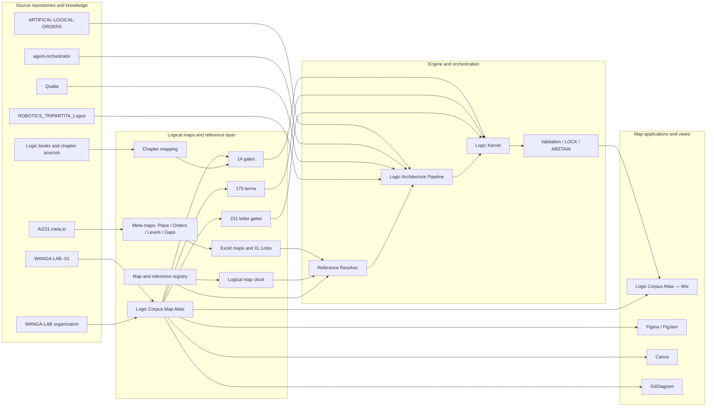

# AI Logic Factory — Top-Level Architecture Map v1

**Status:** ARCHITECTURE_MAP / INITIAL_INTEGRATION / NOT_RUNTIME_VERIFIED  
**Scope:** Repositories and artifact links gathered in the current work session.  
**Rule:** A link in this map establishes a reference, not proof that the referenced system is operational or synchronized.

## Architecture

## Source links

- WANGA-LAB.-01: https://github.com/AmbassadorOv/WANGA-LAB.-01
- ARTIFICAL-LOGICAL-ORDERS: https://github.com/AmbassadorOv/ARTIFICAL-LOGICAL-ORDERS
- agent-orchestrator: https://github.com/AmbassadorOv/agent-orchestrator
- Project-AI231-Miorna: https://github.com/AmbassadorOv/Project-AI231-Miorna
- WANGA-LAB (organization): https://github.com/Quadruple-Multilevel-projection-project/WANGA-LAB
- Qualia: https://github.com/Quadruple-Multilevel-projection-project/Qualia
- AI231.meta.io: https://github.com/Quadruple-Multilevel-projection-project/AI231.meta.io
- ROBOTICS_TRIPARTITA_Logos: https://github.com/AmbassadorOv/ROBOTICS_TRIPARTITA_Logos

## Map artifacts

- Master Map Atlas: https://github.com/AmbassadorOv/WANGA-LAB.-01/blob/main/docs/LOGIC_CORPUS_MAP_ATLAS_V1.md
- 14-gate index: https://github.com/AmbassadorOv/WANGA-LAB.-01/blob/main/milaot-hahigayon/INDEX.md
- 175-term orchestrator: https://github.com/AmbassadorOv/WANGA-LAB.-01/blob/main/milaot-hahigayon/ORCHESTRATOR.md
- 231 letter-gate map: https://github.com/AmbassadorOv/WANGA-LAB.-01/blob/main/research/data/LETTER_GATE_MAP_231_V1.json
- Page-to-gate map: https://github.com/AmbassadorOv/WANGA-LAB.-01/blob/main/research/data/LOGIC_CORPUS_PAGES_GATES_V1.json
- Page submaps: https://github.com/AmbassadorOv/WANGA-LAB.-01/blob/main/research/data/LOGIC_CORPUS_PAGES_SUBMAPS_V1.json
- Chapter mapping schema: https://github.com/AmbassadorOv/WANGA-LAB.-01/blob/main/first-order-logic/sources/more-nevukhim/CHAPTER-MAPPING-SCHEMA.md
- Logic Kernel: https://github.com/AmbassadorOv/WANGA-LAB.-01/tree/main/logic_engine_v1
- Pipeline: https://github.com/AmbassadorOv/WANGA-LAB.-01/blob/main/docs/RESEARCH/FUTURE_LOGIC_ARCHITECTURE_PIPELINE.md
- Gate 13 validation matrix: https://github.com/AmbassadorOv/WANGA-LAB.-01/blob/main/docs/LOGIC/MILOT_HIGAYON_GATE_13_VALIDATION_MATRIX.md
- Maimonides integration: https://github.com/AmbassadorOv/WANGA-LAB.-01/blob/main/research/maimonides/integration/guide-ii-1-to-4_x_milaot-9-to-14.md
- Wix Logic Corpus Atlas: https://headless-jhbcjnxnldu-beywolf5-1408.wix-site-host.com/logic-corpus-atlas.html
- Prior organization integration folder: https://github.com/Quadruple-Multilevel-projection-project/WANGA-LAB/tree/main/docs/LOGIC_FACTORY

## GitDiagram status

At generation time, GitDiagram reported no existing diagram for each checked repository. Open these links to generate repository-specific diagrams:
- https://gitdiagram.com/ambassadorov/wanga-lab.-01
- https://gitdiagram.com/ambassadorov/artifical-logical-orders
- https://gitdiagram.com/ambassadorov/agent-orchestrator
- https://gitdiagram.com/quadruple-multilevel-projection-project/wanga-lab
- https://gitdiagram.com/quadruple-multilevel-projection-project/qualia
- https://gitdiagram.com/quadruple-multilevel-projection-project/ai231.meta.io
- https://gitdiagram.com/ambassadorov/robotics_tripartita_logos

## Runtime update contract — proposed, not implemented

1. A source-file, spreadsheet, map, or link change creates a change record.
2. The record identifies source repository, path/URL, revision or content hash, affected map IDs, affected references, and observed timestamp.
3. The logical map clock advances only after the map registry records the change and its affected references.
4. XL links and application views resolve through the registry; they must not maintain independent competing reference lists.
5. A changed reference is marked stale until re-resolved and checked.
6. Validation status remains explicit: VERIFIED, DERIVED, HYPOTHESIS, UNRESOLVED, or REJECTED.
7. LOCK is permitted only when the relevant source and map validations pass; otherwise return ABSTAIN.

## Not yet established

- The four latest Excel workbooks were not present in the inspected WANGA repository trees.
- The 13 diagrams are represented here as architecture inputs, not yet checked in as separate diagram files.
- No live synchronization between GitHub, Excel, Wix, Figma, Canva, and the logical map clock has been demonstrated.
- GitDiagram has not yet generated repository-specific diagrams for the checked repositories.
- The architecture map itself is not a runtime implementation or a contract verification result.
