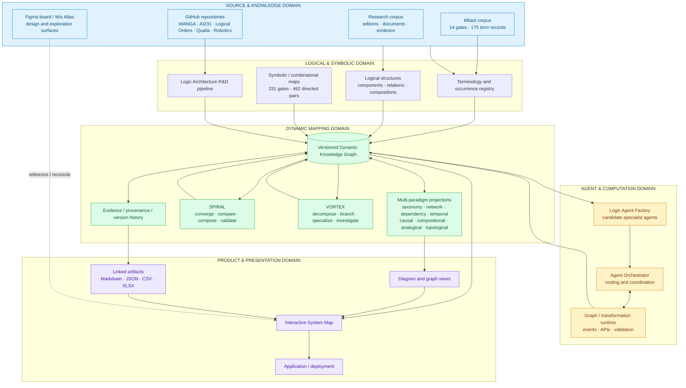

# System Universe Diagram V1

**Status:** Initial architecture projection; links between external projects remain provisional until inspected.

## Reading rules

- Solid arrows show proposed data or execution flow, not proof of deployed integrations.
- Dashed arrow means a design/reference surface to be reconciled against source artifacts.
- The graph is the evolving data model; diagrams are projections.
- Spiral and Vortex are operations over the graph, not static layers.
- 231 gates / 462 directed pairs are recorded as combinatorial structures only until semantic roles are source-verified.

## Execution record

- Timestamp: 2026-11-18T00:38:00+02:00
- Contract_Start_Time: 2026-11-17T20:12:00+02:00
- Action_ID: GH_CREATE_FILE_SYSTEM_UNIVERSE_DIAGRAM_V1
- SHA256: 80fd0546dc1241f9a23f642e7a25da98c0c409d3255f914d635b0804b7e0c829
